# GLOUTON : ta calculatrice est vivante, et elle a faim

**GLOUTON remplace l'écran d'accueil de la calculatrice NumWorks (n0120) par
une créature en gelée qui vit dedans.** Il n'y a plus de menu : tes applis sont
des bonbons qui flottent dans son terrarium, et pour en ouvrir une, **Glouton
la mange**. Il sort la langue, l'avale, la mâche, rote, et l'appli s'ouvre…
dans son ventre. Quand tu reviens, il te recrache.

Et surtout : **il mange les résultats de tes vrais calculs.** Tape `6×7` dans
Calculs, reviens à l'accueil : un biscuit « 42 » lui tombe dessus, et il te
dit ce qu'il en pense.

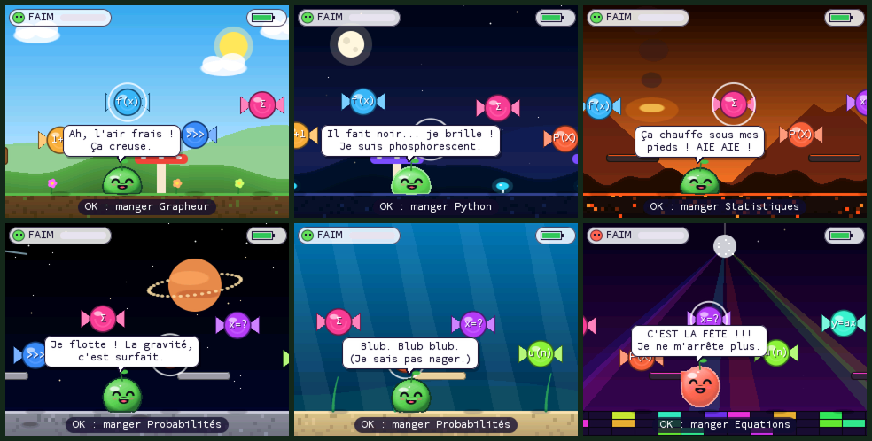

<p align="center">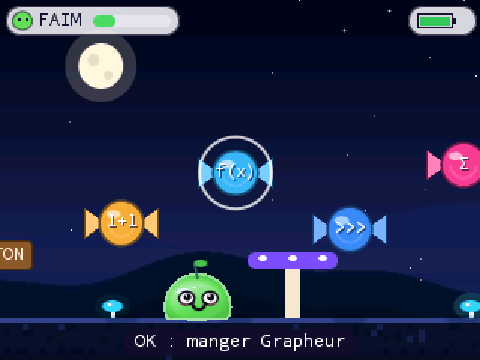</p>

## Ce que fait GLOUTON

- **Un vrai corps mou.** Glouton n'est pas une image animée : c'est une
  simulation physique (un anneau de 20 points qui reviennent vers leur forme,
  avec gravité, rebonds et frottements). Il s'écrase quand il atterrit,
  s'étire quand il saute, tremble quand tu le chatouilles. Il est
  translucide : on voit ce qu'il digère à travers sa gelée.
- **Les applis sont des bonbons.** Approche-toi d'un bonbon, appuie sur
  **OK** : la langue part, attrape le bonbon, Glouton le mâche (miettes
  comprises), fait **BUUURP**, et l'écran se referme sur sa bouche pendant
  que l'appli s'ouvre. Il prend la couleur de ce qu'il vient de manger.
- **Il mange tes calculs.** Chaque résultat de l'appli Calculs devient un
  biscuit qui pleut dans le terrarium quand tu reviens. Glouton réagit au
  nombre :

  | Tu calcules… | Glouton… |
  | --- | --- |
  | `42` | se sent sage (la réponse à tout) |
  | `π` | fait la fête : c'est son plat préféré |
  | `666` | devient rouge, maléfique, et l'écran avec lui |
  | `0/0` (undef) | tombe malade, vire au vert et fait des bulles |
  | `1+1` | est vexé que tu aies eu besoin de lui pour ça |
  | un nombre premier | le trouve croquant |
  | un nombre négatif | grimace : c'est acide |
  | un nombre énorme | grossit de 500 g et manque d'exploser |
  | l'infini | gonfle… jusqu'à exploser |

  Et il y en a d'autres (`7`, `69`, `404`, `1337`, `0`, `1`…).
- **Il contrôle la vraie calculatrice.** La **LED** du haut bat comme un
  cœur, de la couleur de Glouton (plus vite quand il a faim, rouge quand il
  est en colère, arc-en-ciel en disco). Quand il s'endort, il **baisse la
  luminosité de l'écran** ; quand il explose, l'écran flashe. (Désactivable
  dans son carnet, et jamais en mode examen.)
- **Il a faim, pour de vrai.** Sa jauge de faim monte avec le temps. Affamé,
  il grogne, son ventre gargouille, puis **il croque des morceaux de ton
  écran** (des bouchées noires apparaissent sur les bords). Nourris-le et ça
  repousse.
- **Il grandit.** Chaque repas lui donne de l'expérience : Bébé Glouton,
  Glouton Ado (une petite pousse sur la tête), Glouton Adulte, puis **GLOUTON
  SUPRÊME**, qui porte une couronne et ondule de couleur. Grandir débloque un
  sixième décor secret.
- **Les touches de maths font des choses absurdes à Glouton** :

  | Touche | Effet |
  | --- | --- |
  | x² | il gonfle… et à la cinquième fois, il **explose** en gouttes qui se rassemblent |
  | √ | il rétrécit |
  | × | il se **clone** (jusqu'à 7 mini-Gloutons qui le suivent) |
  | ÷ | les clones fusionnent avec lui |
  | sin | danse sinusoïdale |
  | cos | change de costume (chapeau de fête, haut-de-forme, couronne, lunettes, moustache, auréole) |
  | tan | bronzage (et lunettes de soleil) |
  | i | il devient **imaginaire** : presque invisible, il flotte |
  | − | **gravité négative** : il tombe au plafond |
  | ln | il dort comme une bûche |
  | ⌫ | tu le chatouilles (six fois : il se fâche) |
  | + | un en-cas au hasard |
  | Ans | une blague |
  | π | la fête du π |

- **Six décors**, touches **1 à 6**, chacun avec sa physique : Jardin
  (soleil, nuages, fleurs), Nuit (étoiles, lucioles, champignons qui
  brillent, et Glouton devient phosphorescent), Volcan (le sol brûle : il
  saute tout seul en criant), Espace (gravité faible, planète à anneaux,
  comète), Aquarium (il flotte, algues, rayons de lumière, bulles), et Disco
  (secret : piste qui clignote, boule à facettes, il ne peut pas s'empêcher
  de danser).
- **Il a une vie.** Il commente ce que tu fais : il renifle les bonbons (« Python !
  Ça sent le serpent »), râle quand tu reviens d'un jeu (« Tu as joué SANS
  MOI ?! »), compte les minutes où tu l'as laissé seul, raconte des blagues,
  s'ennuie, sifflote, et s'endort au bout de 35 secondes (avec une bulle au
  nez). Il sursaute quand tu le réveilles.
- **L'éclosion.** Au premier démarrage, un œuf tremble sur le sol, la LED
  bat comme un cœur, « toc… toc… » (appuie sur des touches pour l'aider à
  sortir), et Glouton éclot.
- **Le frigo** (touche **Retour**) : toutes les applis et tous les jeux sur
  des étagères. Choisis, et le bonbon vole jusque dans sa bouche.
- **Son carnet de santé** (touche **boîte à outils**) : poids, faim, nombres
  et applis mangés, plat préféré, dernier repas, âge, stade d'évolution, et
  la liste des touches magiques.
- **Les jeux `.nwa`** sont des paquets cadeaux au bout du terrarium, avec
  l'icône du jeu dessus.
- **Barre de titre vert gelée** dans les applis, au lieu du jaune NumWorks.
- **Installateurs en un clic pour Mac et pour Windows** : une page web
  locale qui détecte la calculatrice, gère tes jeux et installe tout avec un
  bouton. Sur Windows, un simple `.exe` : ni Python ni pilote à installer.

<p align="center">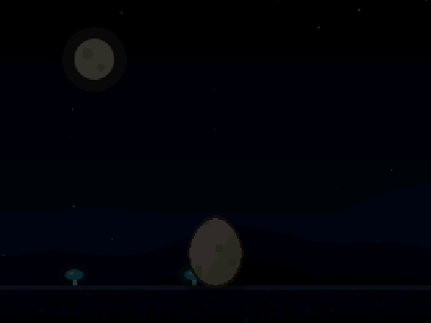</p>

## Les commandes

| Touche | Action |
| --- | --- |
| ◀ ▶ | se déplacer |
| ▲ ou EXE | sauter (maintiens pour sauter plus haut) |
| ▼ | s'écraser (en l'air : plongeon) |
| OK | la langue : manger le bonbon ou le biscuit visé |
| Retour | le frigo |
| Boîte à outils | le carnet de santé |
| 1 à 6 | changer de décor |
| Var | mode photo (sans jauges) |
| x², √, ×, ÷, sin, cos, tan, i, −, ln, ⌫, +, Ans, π | voir plus haut |

## Captures

| | |
| --- | --- |
| 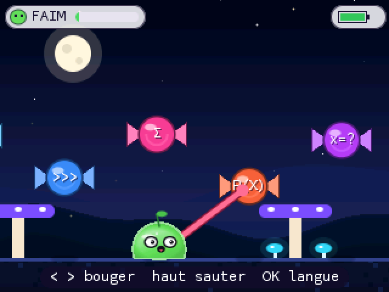 | 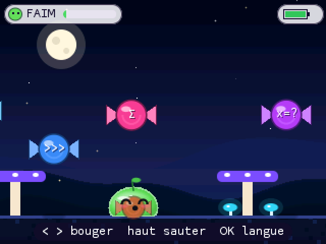 |
| La langue attrape un bonbon | Il le mâche : on le voit à travers |
| 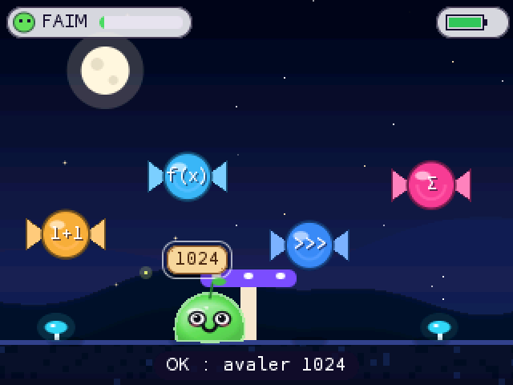 | 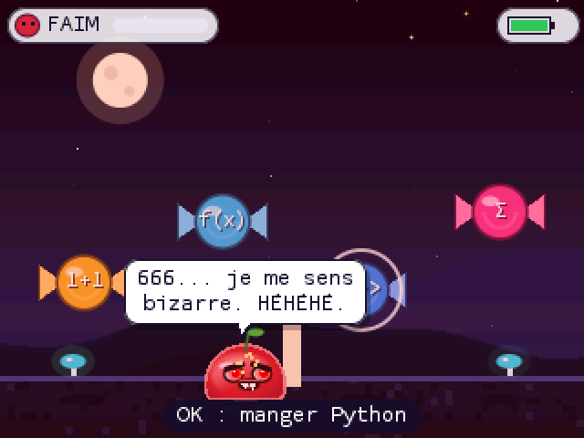 |
| Un résultat de Calculs lui tombe dessus | Il a mangé 666 |
| 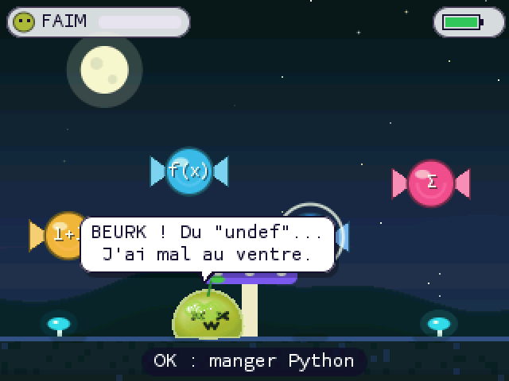 | 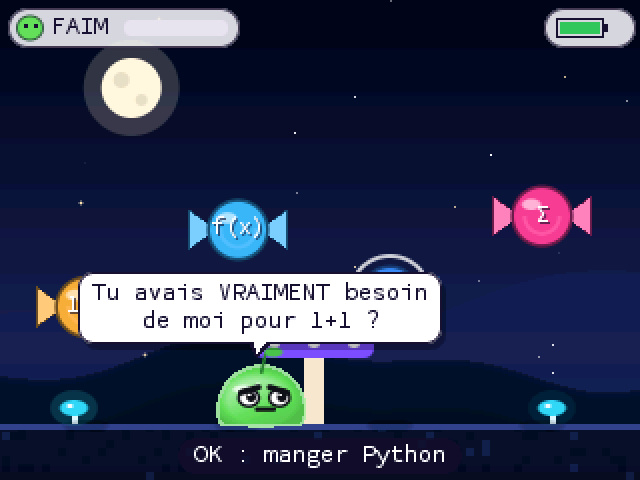 |
| Il a mangé un « undef » | Il a mangé 1+1 |
| 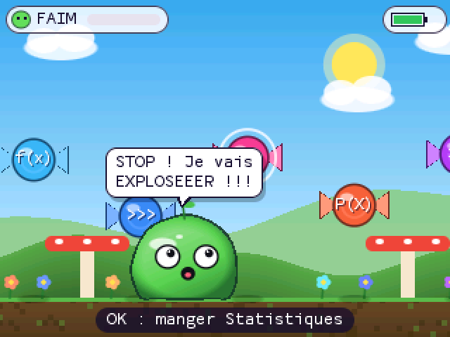 | 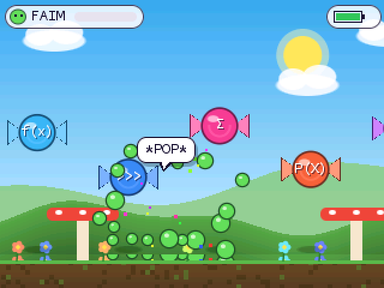 |
| x², x², x², x²… | …x² |
| 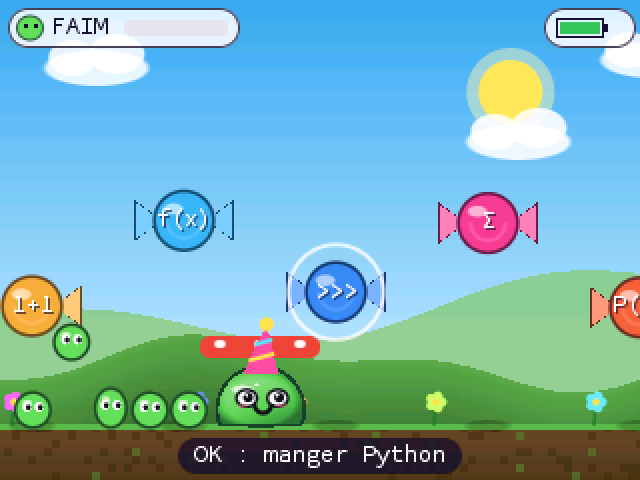 | 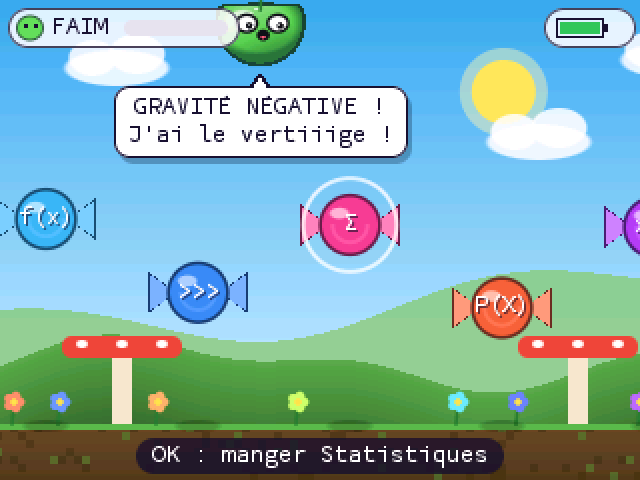 |
| ×, ×, ×, ×, × et cos | Gravité négative |
| 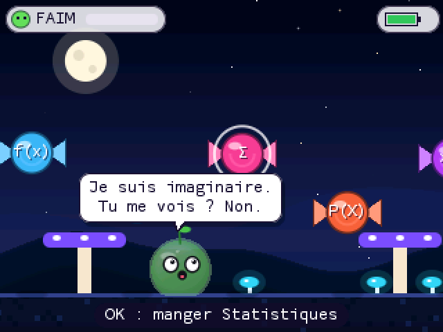 | 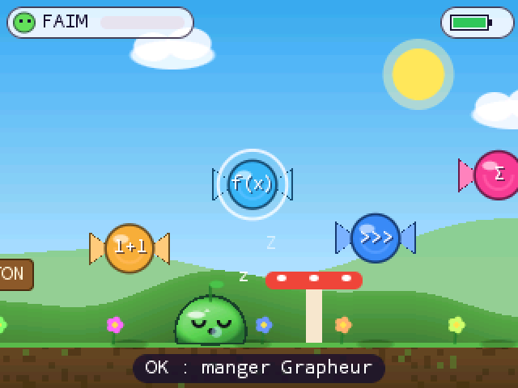 |
| Glouton imaginaire | La sieste |
| 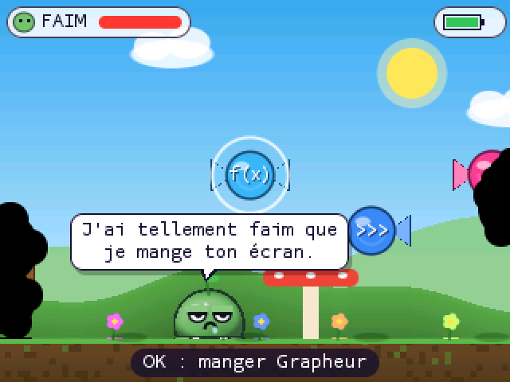 | 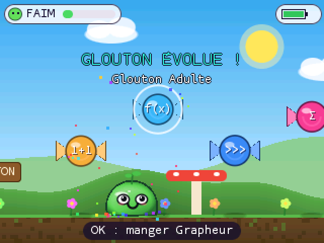 |
| Affamé : il mange l'écran | Il évolue |
| 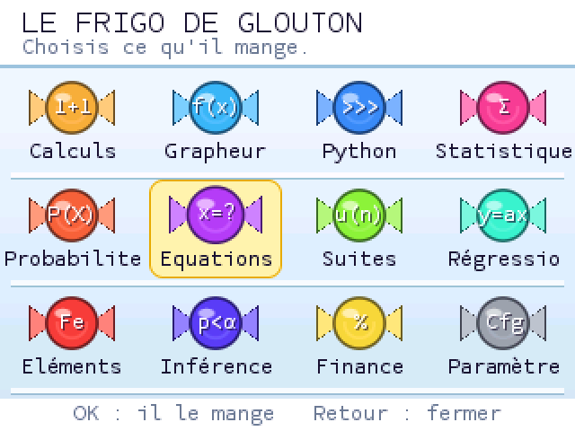 | 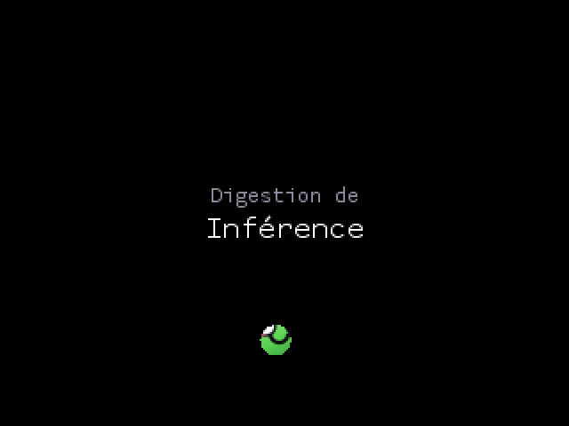 |
| Le frigo | L'appli s'ouvre dans son ventre |
| 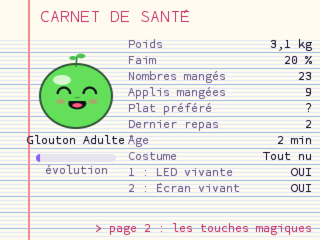 | 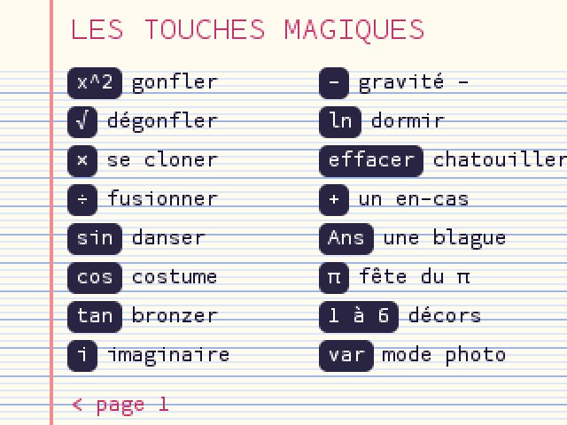 |
| Le carnet de santé | Les touches magiques |
| 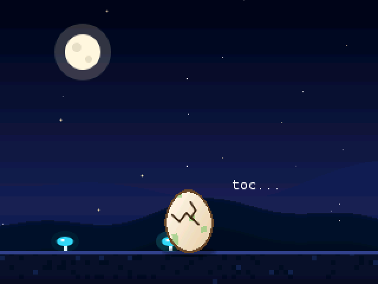 | 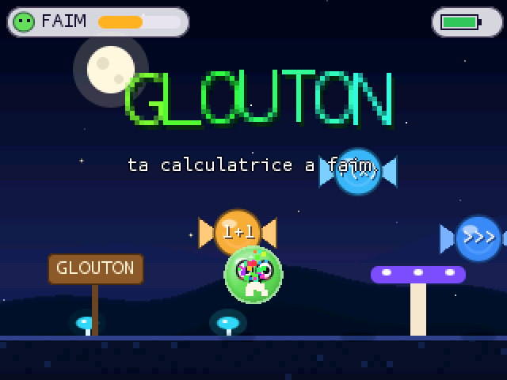 |
| L'œuf | L'éclosion |

## Installation

### 1. Obtenir GLOUTON

Depuis juillet 2021, le code d'Epsilon (le logiciel de la NumWorks) n'est plus
sous licence libre. GLOUTON ne publie donc **aucun code ni aucun firmware de
NumWorks** : seulement un **patch** (`patches/glouton-epsilon.patch`) et son
propre code. Le firmware se compile à partir des sources officielles de
NumWorks, dans ton compte GitHub ou sur ton Mac.

**Sans rien compiler (Mac ou Windows)**

1. En haut de cette page : **Use this template** > **Create a new repository**,
   coche **Private** (obligatoire : la compilation refuse de tourner dans un
   dépôt public, pour que le firmware ne soit pas téléchargeable par tous).
2. Facultatif : ajoute tes jeux `.nwa` dans le dossier `games/` de ta copie
   privée (*Add file* > *Upload files*). Ils seront préparés et inclus dans
   l'installateur, et apparaîtront en paquets cadeaux.
3. Dans ta copie : onglet **Actions** > **Build GLOUTON** > **Run workflow**.
4. Environ 15 minutes plus tard, en bas de la page de la compilation,
   télécharge **GLOUTON-Mac** ou **GLOUTON-Windows** et décompresse-le
   (deux fois pour la version Mac : GitHub met le zip dans un zip).

**En compilant sur ton Mac**

```bash
brew install make dfu-util libusb
brew install --cask gcc-arm-embedded
git clone https://github.com/derim00/glouton.git && cd glouton
./scripts/build-firmware.sh
```

Le script télécharge Epsilon au commit indiqué dans `EPSILON_COMMIT`
(Epsilon 26.1, la dernière version publiée par NumWorks), applique le patch,
compile, prépare les jeux de `games/` et remplit le dossier `installer/`.

### 2. Installer sur la calculatrice

**Sur Mac**

1. Une seule fois : `brew install libusb dfu-util` (et
   `brew install --cask gcc-arm-embedded` pour ajouter d'autres jeux).
2. Double-clique sur **`Installer GLOUTON.command`** (la première fois :
   clic droit > **Ouvrir**). La page de l'installateur s'ouvre
   (http://127.0.0.1:8769).

**Sur Windows** (rien à installer : ni Python, ni pilote)

1. Décompresse **GLOUTON-Windows** (clic droit > *Extraire tout*) : ne
   lance pas l'installateur depuis l'intérieur du zip.
2. Dans le dossier `GLOUTON`, double-clique sur **`Installer GLOUTON.exe`**
   (si SmartScreen s'affiche : *Informations complémentaires* > *Exécuter
   quand même*). Une fenêtre noire s'ouvre avec la page de l'installateur dans
   ton navigateur : laisse-la ouverte, et ferme-la à la fin pour quitter.

**Ensuite, sur les deux**

3. Branche la calculatrice en USB et appuie sur **Reset** au dos : elle
   redémarre sur le système officiel.
4. Quand le voyant passe au vert, glisse tes jeux `.nwa` dans la page si tu
   veux, puis clique sur **Installer GLOUTON**.

L'installateur vérifie que le **slot B** est libre avant d'écrire : le système
officiel (slot A) n'est jamais modifié. Il prépare les jeux pour leur place
dans le slot B (comme le fait le site de NumWorks), les copie, les relit pour
les vérifier, puis installe GLOUTON et le démarre.

## À savoir

- **Calculatrice** : NumWorks **n0120**, avec le logiciel officiel
  **26.4.0** dans le slot A. GLOUTON est compilé à partir d'Epsilon 26.1 (la
  dernière version publiée) avec le numéro de version 26.4.0.
- **Mémoire** : Glouton (son corps, sa faim, ses clones, son carnet) reste en
  mémoire quand tu ouvres une appli : il t'attend. Il repart de zéro (avec
  une nouvelle éclosion) après un Reset.
- **Ses repas** : seuls les résultats calculés depuis le dernier démarrage
  comptent, et seulement les 6 derniers à chaque retour (sinon il
  s'étoufferait).
- **LED et luminosité** : Glouton ne touche à la LED et à la luminosité que
  sur son écran ; elles redeviennent normales dès que tu ouvres une appli.
  Tu peux couper les deux dans son carnet (touches **1** et **2**). En mode
  examen, il n'y touche jamais (la LED sert à signaler le mode examen).
- **Batterie** : Glouton est animé en continu ; quand il dort (35 secondes
  sans toucher à rien), il ralentit et baisse l'écran.
- **Après un Reset**, la calculatrice revient sur le système officiel :
  GLOUTON reste dans le slot B, il suffit de relancer l'installation.
- **Un seul système dans le slot B** : GLOUTON remplace
  [NUMVERSE](https://github.com/derim00/numverse),
  [PSP-OS](https://github.com/derim00/psp-os),
  [Switch-OS](https://github.com/derim00/switch-os) ou
  [Windows-OS](https://github.com/derim00/windows-os) s'il était installé,
  et inversement. Les installateurs peuvent tourner en même temps (ports 8765
  à 8769).
- **Touches Home et On/Off** : sur un logiciel non officiel, le système de la
  calculatrice gère lui-même ces deux touches. GLOUTON efface au démarrage le
  point de retour laissé par le système officiel pour que Home ramène à
  Glouton ; si la calculatrice revient quand même sur le slot A, utilise
  **Retour** (↩) pour revenir à Glouton depuis une appli.
- **Mode examen** : GLOUTON garde les règles du mode examen d'Epsilon
  (applis interdites, jeux bloqués).
- **Jeux** : seulement des applis `.nwa` dont tu as le droit de te servir, et
  uniquement dans ta copie privée : jamais dans ce dépôt public.

## Comment c'est fait

| Fichier | Rôle |
| --- | --- |
| `patches/glouton-epsilon.patch` | Glouton (`apps/home/glouton`), le branchement des résultats de Calculs, l'animation continue (`escher`), la barre verte, le correctif Home / On-Off |
| `apps/home/glouton/blob.cpp` (dans le patch) | le corps mou : points, rotation optimale de la forme de repos, gravité, plateformes, rendu en gelée translucide |
| `apps/home/glouton/shell.cpp` (dans le patch) | Glouton : décors, bonbons, langue, digestion, réactions aux nombres, faim, évolution, clones, LED, frigo, carnet, éclosion |
| `apps/home/glouton/food.cpp` (dans le patch) | les derniers résultats de l'appli Calculs, que Glouton mange en revenant |
| `apps/home/glouton/gfx.cpp` (dans le patch) | le dessin par bandes de 12 lignes : ellipses et traits lissés, polygones, texte, icônes des jeux |
| `scripts/build-firmware.sh` | télécharge Epsilon, applique le patch, compile, prépare l'installateur |
| `scripts/photos.py` | transforme la séance photo du simulateur en images de ce README |
| `installer/server.py` | serveur local (127.0.0.1 uniquement) de l'installateur, Mac et Windows |
| `installer/dfu_launch.py` | lance l'outil DFU de NumWorks avec libusb (Homebrew ou `libusb-package`) |
| `scripts/build-windows-installer.py` | fait `Installer GLOUTON.exe` avec PyInstaller (sur Windows, dans le workflow) et le teste |
| `installer/index.html` | la page de l'installateur |
| `installer/link_games.py` | place chaque jeu `.nwa` à son adresse dans le slot B, comme le site de NumWorks |
| `installer/Installer GLOUTON.command` | lanceur en double-clic pour Mac |
| `.github/workflows/build.yml` | compilation dans ta copie privée, avec les deux installateurs |

Le simulateur sait faire une séance photo : compilé pour macOS et lancé avec
`GLOUTON_SHOTS=<dossier>` (`Epsilon -h --open-app home`), il enregistre les
images de ce README (ce code n'existe pas dans le firmware de la
calculatrice), que `scripts/photos.py` convertit en PNG et en GIF.

## Licence

Le code de GLOUTON est sous licence **CC BY-NC-SA 4.0** (voir `LICENSE`).
Epsilon reste la propriété de NumWorks et n'est pas inclus dans ce dépôt.
GLOUTON est un projet de fan, sans lien avec NumWorks.
